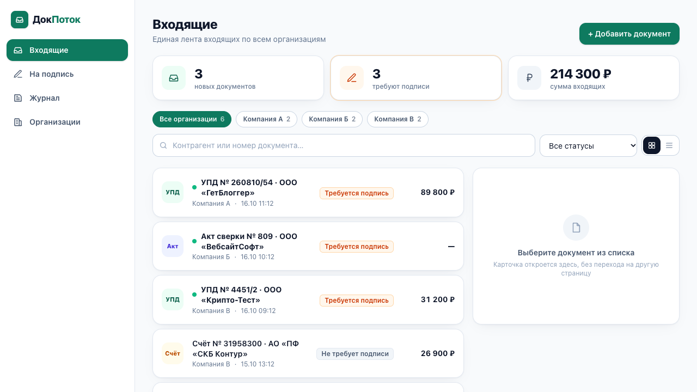
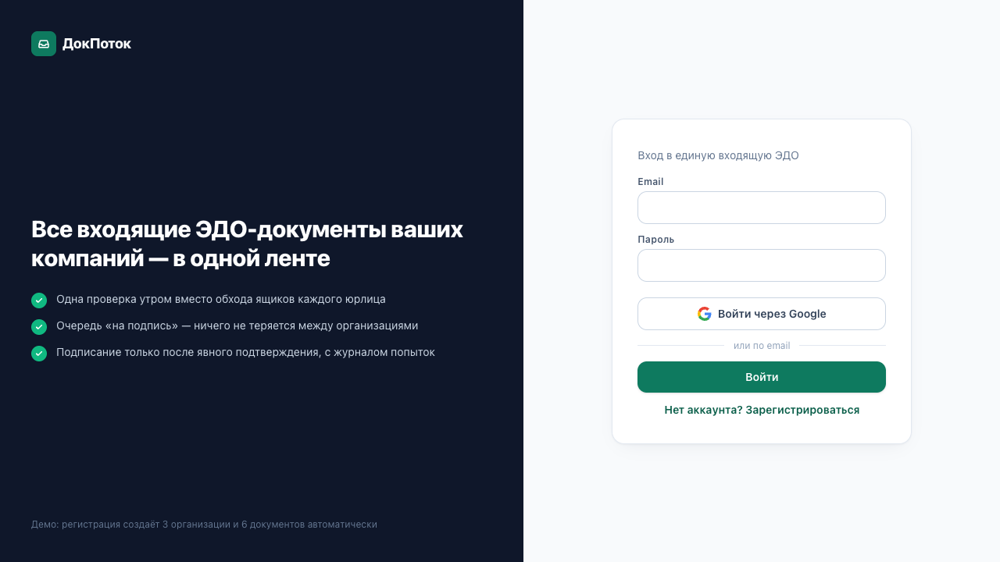

# Итерации интерфейса по замечаниям защиты

Две итерации по замечаниям преподавателя. Первая убрала дефекты вёрстки и добавила состояния; вторая — по замечанию «интерфейс выглядит сгенерированным нейросетью» — убрала маркеры нейрослопа и натянула на приложение готовую дизайн-систему в формате [DESIGN.md](../DESIGN.md).

| До (итерация 1) | После (итерация 2, DESIGN.md) |
|---|---|
|  |  |
|  |  |

## Итерация 2. «Убрать маркеры нейрослопа, взять готовый design.md»

Замечание: «Интерфейс сейчас выглядит как с нуля сгенерированным нейросетью, не убраны маркеры нейрослопа… ожидаю, что вы сможете сделать качественный интерфейс так, как это было показано на уроке: убрать маркеры нейрослопа, взять design.md готовый и натянуть его на приложение. Добавить ещё скролл-эффекты качественные».

### Маркеры нейрослопа, найденные в интерфейсе итерации 1

Честный разбор того, по чему интерфейс читался как «сгенерируй мне админку»:

| Маркер | Где был | Что сделано |
|---|---|---|
| Изумрудный «бренд» + серый slate — дефолтная палитра Tailwind | везде | Палитра Broadsheet: чёрный, серый, белый, один красный акцент |
| Скругления `rounded-xl/2xl` на всём подряд, мягкие тени, `hover:-translate-y` у карточек | карточки, кнопки, поля, чипы | Радиус 0 везде (отключён на уровне темы), теней нет, hover — только фон/рамка |
| Иконки в цветных квадратах (KPI-плитки, логотип, файл, пустые состояния) | KPI, логотип, карточка, StateViews | Цифры-факты серифом с линейками; логотип — словесный знак; иконки только в навигации, тонкие |
| Иллюстрация-«заглушка» в пустом состоянии и круглый значок ошибки | EmptyView, ErrorView | Типографическое пустое состояние: надзаголовок, заголовок, фраза, действие |
| Чек-лист из трёх «преимуществ» с галочками в кружках на тёмной панели входа | AuthGate | Газетная передовица: крупный заголовок, три пронумерованные колонки с линейками, белый фон |
| Пилюли-чипы с цветными фонами по типу документа (УПД/Акт/Счёт/Договор) | DocumentList | Категория — метка uppercase 12px с трекингом, без фона |
| Inter как «шрифт по умолчанию для всего» | html | Пара серифов (PT Serif / Source Serif 4) + моноширинный для цифр |
| Одинаковая визуальная плотность: всё в карточках с отступами | все экраны | Разделение линейками (1px серыми, 2px чёрными), строки-ведомости вместо карточек |
| Эмодзи и декоративные градиенты | — | Не было; проверено, что не появились |

### Что такое DESIGN.md и какая система взята

**DESIGN.md** — открытый формат Google Labs (Stitch) для описания дизайн-системы в одном файле, который читают AI-агенты: YAML-токены (цвета, типографика, радиусы, отступы, компоненты) + markdown-разделы в фиксированном порядке (Overview, Colors, Typography, Layout, Elevation & Depth, Shapes, Components, Do's and Don'ts). Валидируется CLI `@google/design.md`.

Взята готовая система **Broadsheet** (автор chef, галерея designmd.ai, MIT): газетный стиль — серифы, линейки вместо теней, острые углы, скупая палитра. Почему именно она:

- максимально далека от «сгенерированной админки» — ни одного маркера из таблицы выше в ней нет по определению (Don'ts системы прямо запрещают скругления, тени и лишние цвета);
- метафора подходит продукту: входящие документы, журнал, реестр — «бумажные» сущности, лента читается как газетная полоса или бухгалтерская ведомость;
- в ней уже описаны все нужные компоненты: кнопки, карточки, поля, чипы статусов, списки, чекбоксы, тултипы.

Адаптации (зафиксированы в DESIGN.md, раздел Overview): шрифты заменены на пары с кириллицей (Libre Baskerville → PT Serif, Source Serif Pro → Source Serif 4, IBM Plex Mono — оставлен); размеры текста уменьшены под рабочее приложение (тело 15px вместо 18px); добавлены токены контейнеров статусов.

### Как система «натянута» на приложение

1. `DESIGN.md` в корне репозитория — источник правды. `npm run design:lint` (= `npx design.md lint DESIGN.md`) — 0 ошибок; линт добавлен в CI-job `quality`.
2. `src/index.css` — проекция токенов на Tailwind v4: `@theme` с палитрой системы (стандартная палитра Tailwind отключена `--color-*: initial`, чтобы `bg-slate-50` или `text-emerald-600` физически не могли появиться), `--radius-*: initial` и `--shadow-*: initial` (скругления и тени невозможны), шрифты self-hosted через `@fontsource` (CSP `font-src 'self'` не менялся).
3. Компоненты системы — как `@utility`: `h1/h2/h3/figure/caps/label/small/num`, `card/card-elevated`, `btn-primary/secondary/ghost/danger`, `input/input-error`, `chip`, `skeleton`. Компоненты React используют только их и семантические токены (`text-meta`, `border-rule`, `bg-paper-muted`, `text-urgent`).
4. Правило 12 в `CLAUDE.md`: любые изменения интерфейса — по DESIGN.md; новых цветов, радиусов и теней не вводить.

### Скролл-эффекты (по DESIGN.md, Do #12 — сдержанные)

- **Появление при прокрутке** — строки ленты, сводка, фильтры, таблицы и карточки организаций получают класс `reveal` и появляются (opacity + 12px сдвиг, 300 мс, задержка 40 мс × индекс) при входе во вьюпорт. Реализация — `src/lib/reveal.ts`: один `IntersectionObserver` + `MutationObserver` для элементов, добавленных позже; без IntersectionObserver (старые браузеры, jsdom) всё показывается сразу. 3 юнит-теста.
- **Полоса прогресса чтения** — 2px чёрная линейка вверху (`ScrollProgress`), доля прокрутки считается чистой функцией `scrollProgress()` (тест на границы и перескролл).
- **Липкий заголовок раздела** — `PageHeader` следит за сентинелом через IntersectionObserver (без обработчика scroll) и при прокрутке сжимается до одной строки с кнопкой действия.
- **Липкий сайдбар и карточка документа** на десктопе; на экране входа передовица зафиксирована, прокручивается только форма.
- `prefers-reduced-motion: reduce` отключает всё перечисленное.

### Процесс

1. Прочитан формат DESIGN.md (спецификация google-labs-code/design.md) и галерея designmd.ai; скачаны 5 кандидатов (DocuForge, AdminForge, Broadsheet, MiniDash, Open Serif), выбран Broadsheet.
2. Написан DESIGN.md проекта, прогнан линтер; затем переписаны токены, затем компоненты — **контракт тестов не менялся**: все роли, aria-label и тексты кнопок сохранены, 46 тестов (43 прежних + 3 новых) проходят без правок старых.
3. Три цикла «скриншот → правка → скриншот» на локальном dev-сервере (десктоп 1280, мобильный 375): найдены и исправлены (а) утилита `.label` с `display:block` ломала раскладку `<thead>` таблицы — разделена на `caps` (типографика) и `label` (блок); (б) сводка из трёх колонок не помещалась на мобильных — на узких экранах 2 + 1 во всю ширину; (в) тесная строка документа — статус перенесён в строку метаданных, сумма на мобильных — туда же; (г) две липкие шапки на мобильных конфликтовали — шапка приложения прокручивается, липнет заголовок раздела.
4. После деплоя — post-deploy smoke в CI и скриншоты production под свежим пользователем (`scripts/screenshots-prod.mjs`).

## Итерация 1. «Выглядит непроработанным»

Замечание: «интерфейс выглядит совсем непроработанным; не планируете доработать на основании урока по интерфейсам?».

| Проблема | Причина | Что сделано |
|---|---|---|
| Жёсткие **чёрные рамки** у всех карточек и полей | В Tailwind v4 класс `border` без цвета рисует `currentColor` — 25 мест в коде. Это не «вкус», а дефект | Базовый слой `border-color` для всех элементов + единая утилита `.card` |
| Нет визуальной иерархии | Заголовок страницы 18px, всё одного веса; навигация — текстовые ссылки в шапке | Заголовок 24px + подзаголовок; сайдбар с иконками (десктоп) и нижняя панель вкладок (мобильные) |
| Строки документов «одинаковые» | Тип документа — только в тексте; непрочитанность — тонкая полоска слева | Маркер непрочитанного, суммы табличными цифрами, статус-бейдж |
| Загрузка — спиннер в пустом экране | Нет представления о будущей структуре | Скелетон экрана |
| Пустые состояния — текст в рамке | Нет действия | `EmptyView` с действием («Сбросить фильтры») |
| Результат действия незаметен | После подписания менялся только бейдж | Тосты «Подписан: …», «Документ добавлен», «Документ удалён» (`aria-live`) |
| Карточка документа — список строк | Нет шапки, статус теряется | Шапка с типом/организацией и статусом, атрибуты, блок файла, основное действие внизу |
| Фильтр организаций — `<select>` | Не видно распределения документов | Чипсы с количеством |
| Нет табличного режима | Обещан в ТЗ как US-10 | Переключатель «карточки / таблица», выбор сохраняется в `localStorage` |
| Нет единых токенов и фокуса с клавиатуры | Цвета и отступы «по месту», `focus:outline-none` без замены | Токены, утилиты, глобальный `:focus-visible` |

Часть решений этой итерации (цветные плитки, иконки в квадратах, иллюстрация в пустом состоянии, скругления) во второй итерации признаны маркерами нейрослопа и заменены — см. выше. Сохранились структурные решения: сайдбар/нижняя навигация, скелетоны, тосты, чипсы с количеством, табличный режим, master-detail.
